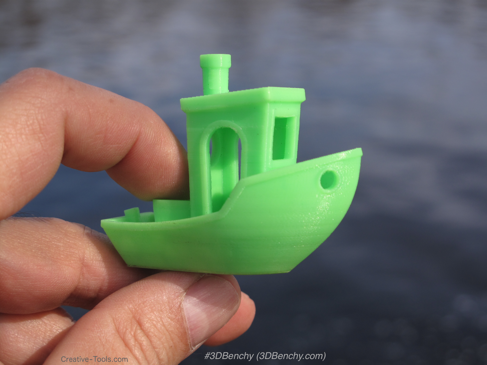

# Week 09 — Iterate & Improve
**Time:** 90 min

### Goals
- Compare v1 vs v2; make evidence-based changes.

### Agenda
- **Warm-up (10):** Compare the completed boat below with the [first-layer detachment](../assets/course-visuals/cc-images/first-layer-detached-failure.jpg). What features can you see in each? The source reports that the tangled print detached; these are separate examples, not a before-and-after pair. Then examine a class print and suggest one evidence-based change.
- **Mini-lesson (10):** Design journal prompts; what did you learn? Use the iteration sheet in the [course visual pack](../assets/course-visuals/README.md).
- **Make (60):** Pick one earlier project; create **v2** with a specific improvement.
- **Queue (10).**

### Deliverables
- `Firstname_Project_v2.stl` + 2–3 sentence reflection.

*“3D-printed 3DBenchy by Creative Tools” by [Creative Tools](https://commons.wikimedia.org/wiki/File:3D-printed_3DBenchy_by_Creative_Tools.jpg), [CC BY 2.0](https://creativecommons.org/licenses/by/2.0/); unmodified. Reference for observation, not a required model.*
