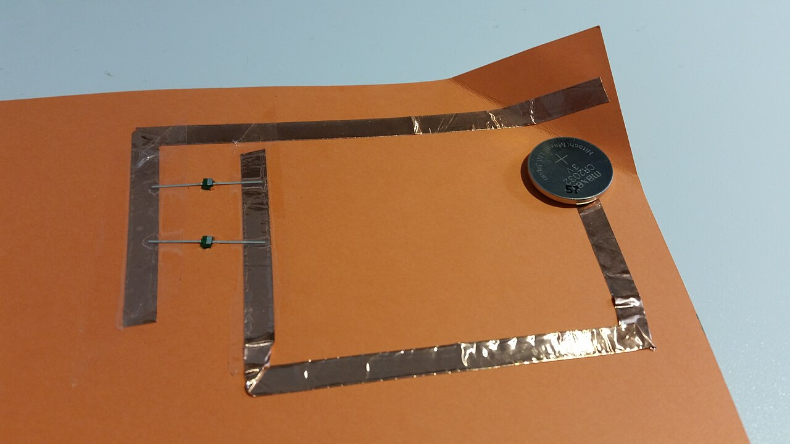
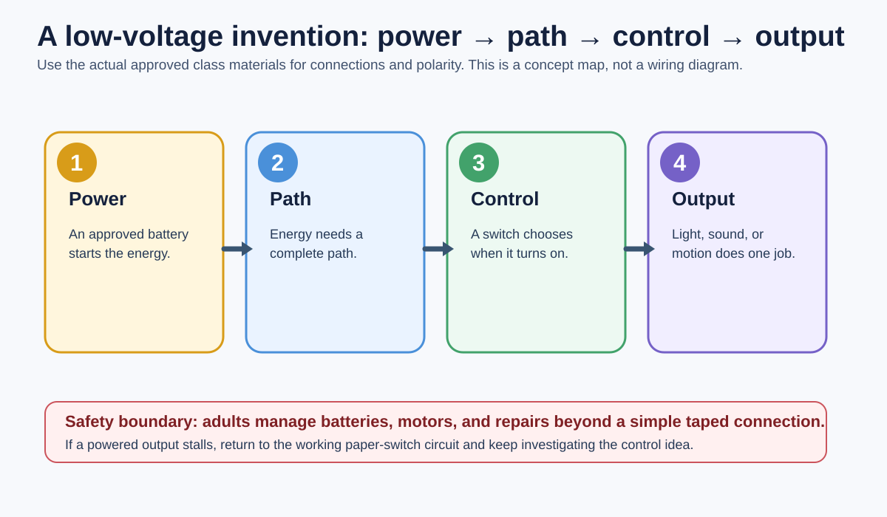

# Energy, Electronics & Circuits

A four-session Grades 3–5 pilot studio where learners make low-voltage systems that light up, make sound, move, and respond to a switch.

> **PILOT READY:** a lead facilitator can deliver this package as written. Keep it off the public-ready shelf until one delivery confirms the parts quantities, device-free fallback, safety routines, and timing.

## Quick start

1. Read [SYLLABUS.md](SYLLABUS.md).
2. Test every battery, LED, buzzer, motor, and switch before learners arrive; remove unreliable parts from rotation.
3. Build one working demo and one deliberate fault for Session 1.
4. Use only the low-voltage materials listed in the syllabus; no mains power or soldering in this pilot.

For Session 1, project this photo before the local demonstration and ask learners to locate the source, paths, and lights. It is an observation prompt, not a wiring guide or permission to operate a circuit. Its exposed coin cell is not this course's battery-handling model: adults manage batteries and check connections before powered testing.

[*Simple paper circuit*](https://commons.wikimedia.org/wiki/File:Simple_paper_circuit.jpeg) by Mosborne01, [CC BY-SA 3.0](https://creativecommons.org/licenses/by-sa/3.0/); resized. See [asset provenance](assets/README.md).

<!-- ponytail: one syllabus contains the whole four-session pilot. Add circuit cards only after a delivery proves live modeling and the embedded prompts are insufficient. -->

## Lineage

Built from the prior course brief and its physical-systems lineage: `CTMSoundDesign`, `3D-Printing-Course-3-5`, `Scratch-Game-Design-Animation_Grades3-5`, and `Digital-Music-Control`.
