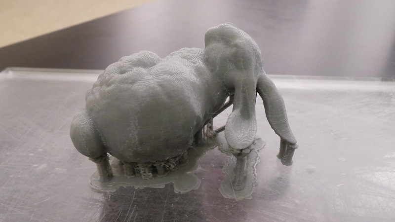

# Student Brief — L03 Printability I Overhangs

## Block A (Learn)
- Watch the demo, record **three printability rules** in your notebook.
- Copy the CAD move sequence and export STL.
- In the photo, find the temporary supports beneath the bunny and its ears. How might orientation or a chamfer change the need for support? Test your own design rather than copying these supports.

*“Stanford bunny resting on a pillow” by [Creative Tools](https://www.flickr.com/photos/creative_tools/14485075381/), [CC BY 2.0](https://creativecommons.org/licenses/by/2.0/); Flickr-provided smaller rendition.*

## Block B (Do)
- Execute the build/test. Log **settings and outcomes** in your test log CSV.
- Submit two images: (1) slicer preview, (2) print result, with a 2–3 sentence reflection.

## Deliverables
- STL + slicer profile (export).
- Test log row in your team CSV.
- Exit ticket (1–2 minute response).

## Safety
- Keep hands clear of moving carriages & hot ends. Safety checklist in `checklists/`.
