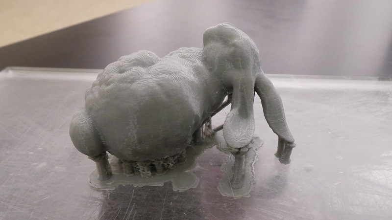

# Teacher Guide — L03 Printability I Overhangs

## Block A — Mini-lesson & Demo
- **Objective:** (Fill) 
- **Slides/Demo:** Live CAD showing today's focus.
- Show this photograph and ask students to locate the temporary supports under the bunny and ears; compare their purpose with orientation or chamfers. The image is one example, not a universal support setting; use the class test and approved slicer setup to decide.

*“Stanford bunny resting on a pillow” by [Creative Tools](https://www.flickr.com/photos/creative_tools/14485075381/), [CC BY 2.0](https://creativecommons.org/licenses/by/2.0/); Flickr-provided smaller rendition.*
- **Key terms:** Additive manufacturing, constraint, datum, overhang angle

## Block B — Studio
- **Task:** See STUDENT.md for brief; circulate and use the **question funnel**: ask to measure, predict, then adjust.
- **Evidence to capture:** Photos of setups, caliper readings, slicer screenshots.

## Materials & Prep
- Test artifacts from `activities/openscad-tests` pre-printed where noted.
- Slicer stations pre-configured for draft prints.
- Whiteboard for common failure modes log.

## Checks for understanding
- Exit ticket prompt in `assessments/checkpoints` for this lesson.
