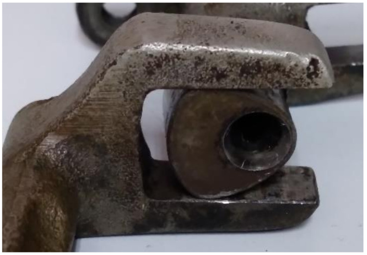

# Student Brief — L03 Cams and Followers

## Block A (Plan)

Figure 2 from [Zayas-Figueras and Buj-Corral (2023)](https://pmc.ncbi.nlm.nih.gov/articles/PMC9960791/), [CC BY 4.0](https://creativecommons.org/licenses/by/4.0/), unchanged. Observe where the cam meets the follower and predict how turning the cam moves it. This is a reference, not a build or operating guide; use only instructor-approved equipment and keep clear of moving parts.

- Sketch the mechanism, list **assumptions**, and identify two risky dimensions.
- Choose parameters in the provided template (SCAD) and export STL.

## Block B (Do)
- Print a coupon or sub-assembly; test on the rig; record results in the log.
- Write a 2–3 sentence reflection on what changed and why.

## Deliverables
- STL(s)/source, rig data (CSV), photo(s), brief reflection, exit ticket.
