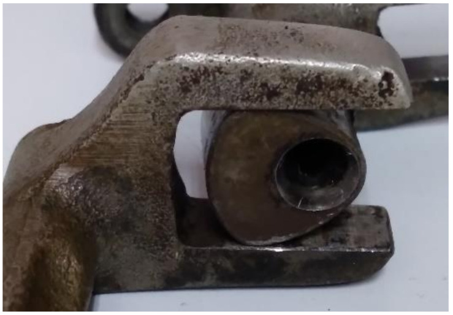

# Teacher Guide — L03 Cams and Followers

## Block A — Concept & Demo

Figure 2 from [Zayas-Figueras and Buj-Corral (2023)](https://pmc.ncbi.nlm.nih.gov/articles/PMC9960791/), [CC BY 4.0](https://creativecommons.org/licenses/by/4.0/), unchanged. Ask students to locate the cam and its double-faced oscillating follower before the live demo. The exposed mechanism is an observation reference, not operating authorization: use instructor-approved equipment and keep hands clear of moving parts.

- Introduce the mechanism concept with 2–3 references and a live demo.
- Emphasize **clearances**, **orientation**, and **failure modes** for printability.

## Block B — Build/Test
- Students print/cut small **coupons** or sub-mechanisms and test on rigs.
- Rotate roles: operator, recorder, photographer, tester.

## Prep
- Pre-slice test coupons and rig parts for the day.
- Stage a failure or mis-fit example for discussion.

## Checks for Understanding
- Exit ticket prompt in `assessments/checkpoints` for this lesson.
