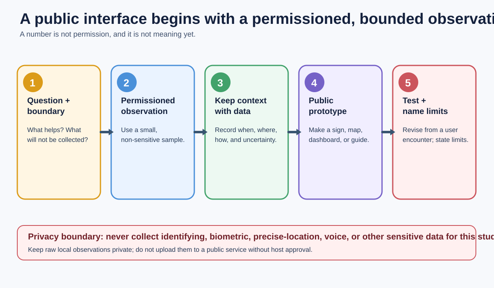

# Public Data, Sensors & Civic Interfaces

A four-session high-school pilot where learners collect a small, permissioned observation, turn it into a public-facing prototype, and explain its privacy boundary.

> **PILOT READY:** A lead facilitator can run the paper-first, low-risk pathway as written. It needs a real delivery review before public promotion.

## Run this

1. Read [`SYLLABUS.md`](SYLLABUS.md); choose one approved local question and one collection method.
2. Confirm the class will not collect identifying, biometric, or sensitive personal data.
3. Prepare paper logs, prototype materials, and the in-room fallback before Session 1.
4. Record consent, privacy, timing, and user-test findings after Session 4.

The visual makes the course’s paper-first privacy gate visible; it does not grant collection permission or permit public upload of raw observations.

**Source lineage:** [`in-progress/public-data-sensors-and-civic-interfaces.md`](../../in-progress/public-data-sensors-and-civic-interfaces.md) (forwarding note after this package was created); `SECONDARY/robotic-vibes`; `POST_SECONDARY/critical-making-civic-media`.
