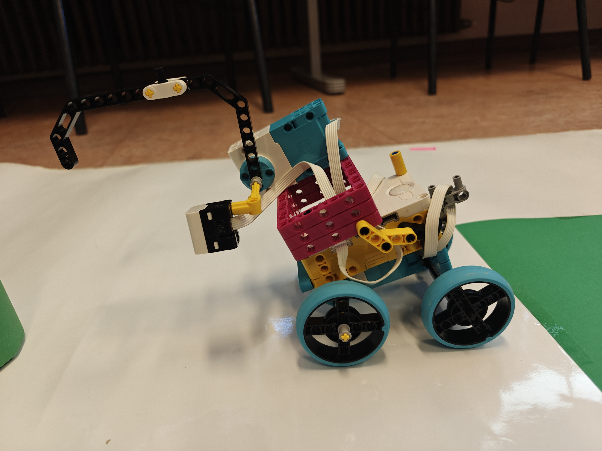

# Start Here: Build Your Driving Base

Example robot, not Driving Base 1: notice the wheels, hub, and cable routing. Your team's build and ports may look different. Photo: Mattruffoni, [CC BY 4.0](https://creativecommons.org/licenses/by/4.0/); [source and credits](../assets/README.md).

1. Open the SPIKE App and use its **Driving Base 1** build guide.
2. Build with your team; do not force parts or pull on cables.
3. Before a test run, check:
   - All sensors connected.
   - Cables tidy and secure.
   - Robot balanced and symmetrical.
4. Ask the instructor to approve the clear test lane, then run the motor test code.

If the robot does not move, stop the program and check the hub charge and cable connections before changing code. Use the instructor's [`Troubleshooting Guide`](../instructor_notes/Troubleshooting.md) with your team.
